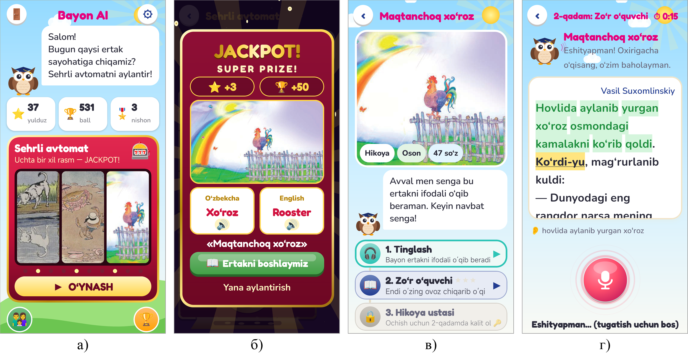
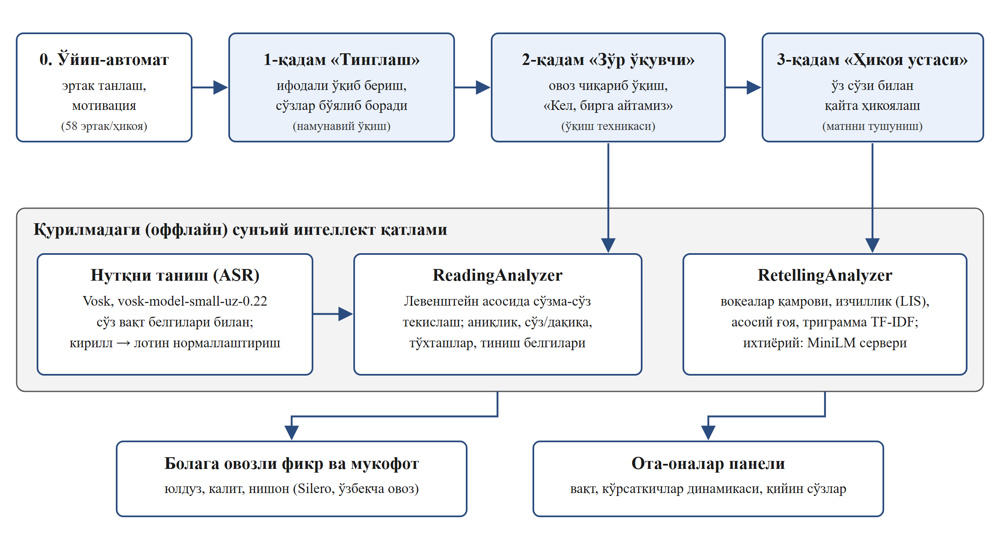

# 📖 Bayon AI

**O‘qish texnikasi · Matnni tushunish · 1–2-sinf · Android · o‘zbek tilida**

Bola ertakni ovoz chiqarib o‘qiydi — sun'iy intellekt har bir so‘zni jonli baholaydi, xatolarni birga bo‘g‘inlab tuzatadi.

## Ilova haqida

«Bayon AI» — 1-sinf o‘quvchisining o‘zbek tilida ovoz chiqarib o‘qish texnikasi va o‘qiganini tushunishini sun'iy intellekt yordamida baholovchi ilova. Ilova qo‘l tegizmasdan ishlaydi: bola o‘yin-avtomatni aylantirib ertak tanlaydi, qolganini Bayon boyqushi ovoz bilan boshqaradi. O‘qish aniqlik, tezlik va to‘xtashlar bo‘yicha, qayta hikoyalash esa voqealar, izchillik va asosiy g‘oya bo‘yicha baholanadi. Google Read Along kabi ilovalar o‘zbek tilini bilmaydi — Bayon AI biladi.

## Imkoniyatlar

- 3 qadam: «Tinglash» → «Zo‘r o‘quvchi» → «Hikoya ustasi»
- Har bir so‘z jonli ranglanadi: yashil — to‘g‘ri, sariq — yaqin, qizil — xato
- «Kel, birga aytamiz»: xato so‘zlar bo‘g‘inlab birga qaytariladi
- 58 ta matn: 26 tasi 1-sinf darsliklaridan, 32 tasi Ezop masallari
- Nutq telefonda internetsiz taniladi (Vosk), o‘zbekcha ovoz
- Ota-onalar paneli: vaqt, ko‘rsatkichlar dinamikasi va qiyin so‘zlar

## O‘yin ssenariysi

1. 1-qadam «Tinglash» — Bayon ertakni ifodali o‘qiydi, so‘zlar matnda bo‘yalib boradi
2. 2-qadam «Zo‘r o‘quvchi» — bola ovoz chiqarib o‘qiydi, o‘qish jonli baholanadi
3. 3-qadam «Hikoya ustasi» — bola ertakni o‘z so‘zlari bilan aytib beradi

## 🏆 Natija

Beshta analog bilan ekspert taqqoslashida **35 balldan 30 ball — 1-o‘rin**.

## O‘rnatish

1. **[bayon-ai.apk](https://github.com/MSoqiy/bayon-ai/raw/main/apk/bayon-ai.apk)** faylini yuklab oling (APK papkasi — [apk/](https://github.com/MSoqiy/bayon-ai/tree/main/apk)).
2. Faylni oching; telefon so‘rasa, «Noma'lum manbalardan o‘rnatish»ga ruxsat bering.
3. «O‘rnatish»ni bosing.

## Ekranlar

## English

**Bayon AI** — AI reading coach that listens to children reading aloud in Uzbek and scores fluency and retelling. Free, ad-free. Part of the «Ta'limiy o‘yinlar» collection by Mamasaidov M.A..

---

**Muallif:** Mamasaidov M.A. — Toshkent shahar Mirzo Ulug‘bek markazi o‘qituvchisi · Tetrasoft · ✉ soqiy65@gmail.com · 🌐 https://msoqiy.github.io · «[Ta'limiy o‘yinlar](https://msoqiy.github.io/oyinlar/)»

**Boshqa ilovalar:** [Otin buvi](https://github.com/MSoqiy/otin-buvi) · [Donish bobo](https://github.com/MSoqiy/donish-bobo) · [Tilbilgich En AI](https://github.com/MSoqiy/tilbilgich-en) · [Tilbilgich Fr AI](https://github.com/MSoqiy/tilbilgich-fr) · [Tilbilgich De AI](https://github.com/MSoqiy/tilbilgich-de) · [Tilbilgich Ar AI](https://github.com/MSoqiy/tilbilgich-ar) · [Aljabr](https://github.com/MSoqiy/aljabr) · [GeoSayyoh](https://github.com/MSoqiy/geosayyoh) · [So‘zla](https://github.com/MSoqiy/sozla)

Kalit so‘zlar: o‘qish texnikasi, o‘qishni o‘rganish, ertaklar bolalar uchun, matnni tushunish, o‘zbekcha sun'iy intellekt, Read Along o‘zbekcha, 1-sinf o‘qish, техника чтения на узбекском, чтение для первоклассников с ИИ, o‘zbekcha ta'limiy o‘yin, android apk
